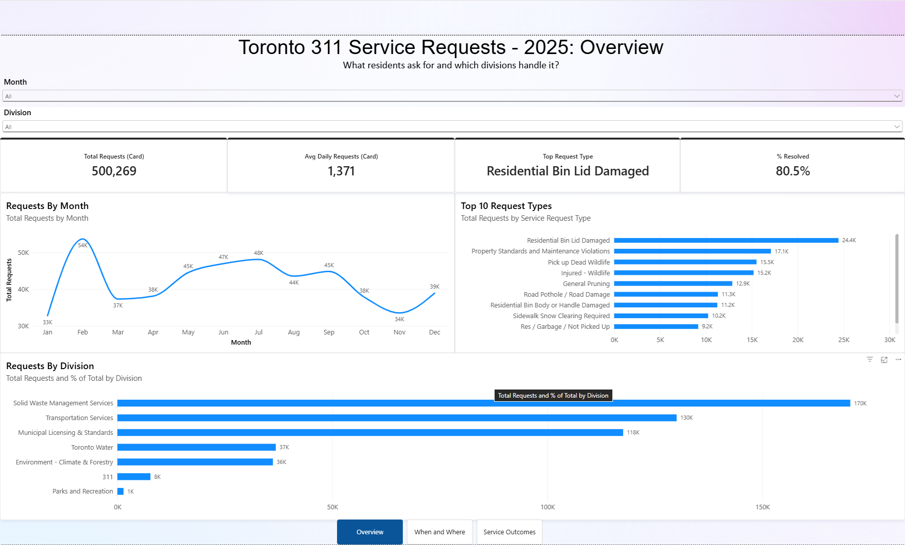
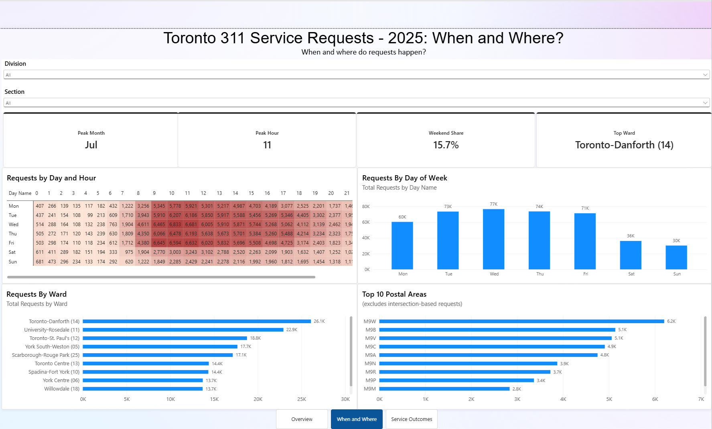
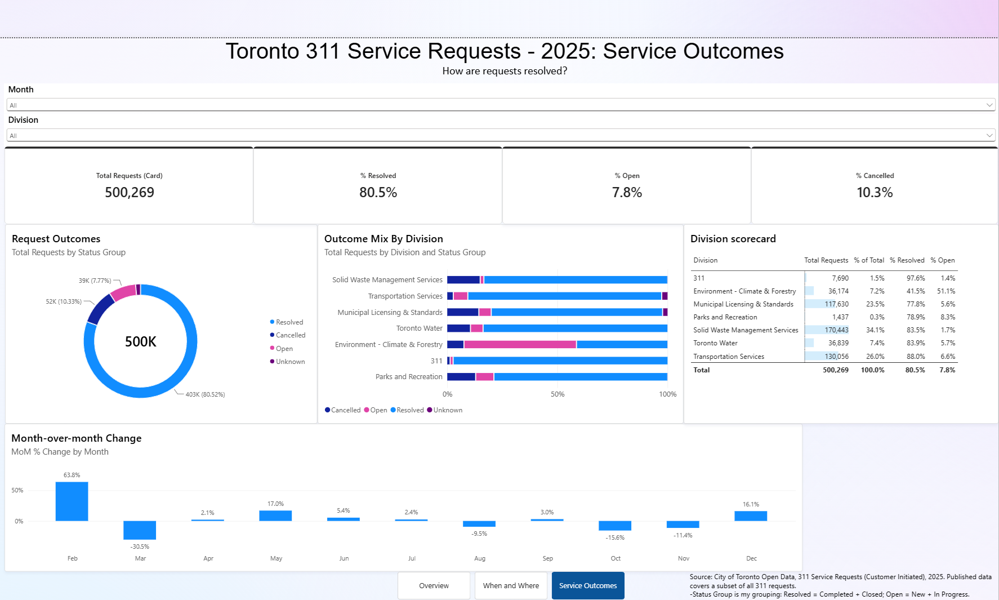

# Toronto 311 Service Requests 2025: Power BI Dashboard

An end-to-end business analytics project: cleaning a messy open dataset of **500,269 service requests**, modelling it in Power BI, and turning it into a three-page dashboard that answers practical questions for city service managers.



## Business Problem

The City of Toronto's 311 service receives hundreds of thousands of non-emergency requests a year, covering everything from damaged recycling bins to potholes and injured wildlife. Raw request logs can't tell a manager where demand is concentrated, when it peaks, or whether requests are actually getting resolved.

**Goal:** turn the 2025 request log into a decision tool for operations managers, division heads and budget planners.

## Questions the Dashboard Answers

1. What are residents asking for most, and how does demand change through the year?
2. When does demand peak (month, day of week, hour of day)?
3. Where is demand concentrated (ward and postal area)?
4. Which divisions carry the heaviest workload?
5. How are requests resolved, and which divisions have the most unresolved work?

## Dataset

- **Source:** City of Toronto Open Data, *311 Service Requests - Customer Initiated* (2025 file, `SR2025.csv`)
- **Size:** 500,269 rows, 9 columns (creation date, status, postal area, intersection streets, ward, request type, division, section)
- **Licence:** Contains information licensed under the Open Government Licence – Toronto.
- **Note:** the published data is a subset of all 311 activity, so findings describe patterns in the published data, not every request the City received.

## Tools

Power BI Desktop · Power Query (M) · DAX · Data modelling · Data visualization

## Data Preparation (Power Query)

I profiled the file before loading it and found several issues that would have silently corrupted the analysis:

| Issue found | Impact | Fix |
|---|---|---|
| Unquoted commas inside two labels ("Environment, Climate & Forestry" and "Transfer, Disposal & Operations") | About 36,200 rows (7.2%) split into extra columns, shifting Division and Section | Imported each line as a single column, replaced the two labels, then split into 9 columns |
| File encoded as Windows-1252, not UTF-8 | Accented characters would load incorrectly | Set the file origin on import |
| 78,457 requests (about 16%) recorded at street intersections instead of a postal code | "Intersection" would have appeared as the top postal area | Added a `Location Type` column (Postal Area / Intersection) and filtered postal-area visuals |
| Six status values with overlapping meanings | Hard to read outcomes | Grouped into `Status Group` (see assumptions) |
| Unneeded columns (intersection street names, raw timestamp) | Larger file, slower model | Extracted `Date` and `Hour`, then removed the originals |

Every step is named in the Applied Steps pane so the cleaning process can be followed.

## Data Model

A simple star-style model:

- **`311 Request`**: one row per request (Date, Hour, Status, Status Group, Ward, Division, Section, Service Request Type, postal area, Location Type)
- **`Date Table`**: calendar table for 2025 (Month, Day Name, Is Weekend), marked as the date table
- **Relationship:** `Date Table[Date]` → `311 Request[Date]`, one-to-many, single direction

## Key DAX Measures

| Measure | Purpose |
|---|---|
| `Total Requests` | `COUNTROWS(311 Request)` |
| `Avg Daily Requests` | Total requests divided by distinct days |
| `% of Total` | Share of requests, respecting current selections |
| `MoM % Change` | Month-over-month change using `DATEADD` |
| `% Resolved`, `% Open`, `% Cancelled` | Outcome shares based on `Status Group` |
| `Weekend Share` | Share of requests on Saturday and Sunday |
| `Peak Hour`, `Top Request Type`, `Top Division`, `Top Ward` | Highest-value items using `TOPN` |
| `Request Type Rank` | `RANKX` for ranked tables |

## Dashboard Pages

### 1. Overview
Total volume, average daily requests, top request types, monthly trend and workload by division.


### 2. When and Where
Day-and-hour heatmap, requests by weekday, by ward, and the top postal areas. Figures on this page are for requests that have a postal code (421,812 requests); intersection-based requests are excluded.



### 3. Service Outcomes
Resolution rates, outcome mix by division, month-over-month change and a division scorecard.



## Key Findings

**Demand is concentrated in a few divisions.**
Solid Waste Management Services (170,443 requests, 34.1%), Transportation Services (130,056, 26.0%) and Municipal Licensing & Standards (117,630, 23.5%) together handle about 84% of all requests. The other four divisions share the remaining 16%.

**A few request types dominate.**
The most common request is *Residential Bin Lid Damaged* (about 24,400), followed by *Property Standards and Maintenance Violations* (about 17,100). Wildlife-related requests (*Pick up Dead Wildlife* and *Injured - Wildlife*) add up to about 30,700 requests, roughly 6% of the total.

**Demand is seasonal.**
February is the busiest month at about 54,000 requests, up 63.8% from January (about 33,000). Summer holds at 44,000-48,000, and November is the second-quietest month at about 34,000. Splitting February by Location Type shows that about 12,600 of its requests were intersection-based, against roughly 4,400-7,100 in other months.

**Demand follows a weekday rhythm.**
Among requests with a postal code, weekdays run from about 60,000 (Monday) to 77,000 (Wednesday) requests, against 36,000 on Saturday and 30,000 on Sunday. Weekends account for 15.7% of these requests. The busiest hours are 9 to 11 AM on weekdays, with 11 AM the single peak hour.

**Geography is uneven.**
Toronto-Danforth (Ward 14) is the top ward at about 26,100 postal-code requests. The Top 10 postal areas chart is led by M9W (about 6,200), followed by M9B and M9V (about 5,100 each).

**Most requests are resolved, but one division stands out.**
Overall, 80.5% of requests are resolved, 7.8% are open and 10.3% (about 52,000) are cancelled. Resolution ranges from 97.6% (311) and 88.0% (Transportation Services) to 77.8% (Municipal Licensing & Standards). **Environment - Climate & Forestry is the outlier:** only 41.5% resolved and 51.1% still open.

## Recommendations

1. **Prioritize capacity planning for the three largest divisions.** They carry about 84% of demand, so small efficiency gains there matter most.
2. **Review the open workload in Environment - Climate & Forestry.** Check whether the open share reflects long-running work (such as planned pruning or planting) or a genuine backlog by looking at how old the open requests are. A longer service target for those request types might be appropriate.
3. **Match staffing to the weekday morning peak** (9 to 11 AM, Tuesday to Thursday), and plan for lighter weekend volume.
4. **Investigate the February spike** by request type and location before the next winter, since it is largely intersection-based.
5. **Capture cancellation reasons.** One in ten requests is cancelled, but the data doesn't say why.

## Assumptions and Limitations

- **Status Group is my own grouping:** Resolved = Completed + Closed; Open = New + In Progress; Cancelled = Cancelled; Unknown = Unknown. The City may define these differently.
- Statuses reflect the time the data was extracted, so recent requests are more likely to appear open.
- The published dataset is a subset of all 311 requests, so totals don't represent every request the City handled.
- About 16% of requests are recorded by intersection and have no postal area, so postal-area and weekday/hour views on page 2 cover only requests with a postal code.
- This is one year of data, so year-over-year comparisons weren't possible.

## Repository Structure

```
├── 311 Service Requests 2025.zip
├── Overview.png
├── README.md
├── Service_Outcomes.png
├── Toronto_311_Dashboard_2025.pbix
└── When_And_Where.png
```

## How to Open

1. Download `Toronto_311_Dashboard_2025.pbix` and open it in Power BI Desktop.
2. If you refresh the data, point the query at your own copy of `SR2025.csv` (Transform data → Source step).
3. The original dataset is available from the City of Toronto Open Data portal.

## About

Built by **Ishan Sevak** as a portfolio project for business analyst and project management roles. Background: MBA (Finance) and graduate certificates in Project Management and Data Analytics.

Connect on LinkedIn: www.linkedin.com/in/ishan-sevak
